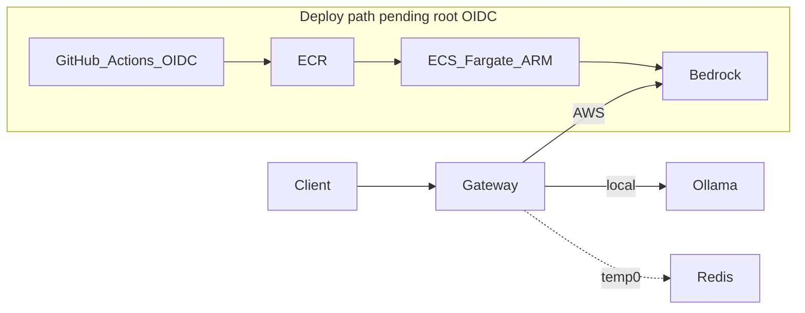

# LLM gateway

Provider-agnostic FastAPI gateway. Same SSE contract for Ollama and Bedrock.

## Features

- `POST /chat/stream` — SSE `token*` → `usage` | `error`
- `POST /chat` — buffered JSON; retries + fallback; `Idempotency-Key`; Redis response cache when `temperature=0` (soft-fail if Redis down)
- Adapters: Ollama (`httpx`) · Bedrock (`ConverseStream` via `asyncio.to_thread`)
- Local auth: `AWS_PROFILE` · ECS: omit profile, use task role

## Layout

```text
src/gateway/
  schemas.py      # request + events
  providers.py    # Ollama + Bedrock
  resilience.py   # timeout, full-jitter retries
  cache.py        # Redis response cache
  main.py         # FastAPI app
docker/dockerfile
.github/workflows/deploy-gateway.yml
infra/gateway/    # OIDC/ECS bootstrap (root for IAM)
docs/adr-001-deploy-target.md
```

## How to run

| Variable | Example | Notes |
|---|---|---|
| `LLM_PROVIDER` | `bedrock` or `ollama` | Default `ollama` if unset |
| `AWS_PROFILE` | `agent-toolkit` | Local only; omit on ECS |
| `AWS_REGION` | `eu-north-1` | |
| `BEDROCK_MODEL` | `eu.amazon.nova-micro-v1:0` | EU inference profile |
| `OLLAMA_URL` | `http://127.0.0.1:11434/api/chat` | Or `host.docker.internal` in Docker |
| `REDIS_URL` | `redis://127.0.0.1:6379/0` | Optional; cache soft-fails |

### Host

```bash
LLM_PROVIDER=bedrock AWS_PROFILE=agent-toolkit AWS_REGION=eu-north-1 \
PYTHONPATH=src .venv/bin/uvicorn gateway.main:app --reload --port 8000
```

### Docker

Use a **writable** `~/.aws` mount so `aws login` can refresh its cache:

```bash
docker build -f docker/dockerfile -t gateway:day27 .
docker run --rm -p 8000:8000 \
  -e LLM_PROVIDER=bedrock \
  -e AWS_REGION=eu-north-1 \
  -e AWS_PROFILE=agent-toolkit \
  -v "$HOME/.aws:/home/appuser/.aws" \
  gateway:day27
```

```bash
curl -N -X POST http://127.0.0.1:8000/chat/stream \
  -H 'Content-Type: application/json' \
  -d '{"provider":"bedrock","messages":[{"role":"user","content":"Say hello in five words."}],"temperature":0}'
```

## Architecture



## Deploy (ADR-001: ECS Fargate ARM)

Target: GitHub OIDC → ECR → ECS Fargate (`eu-north-1`), no ALB for the lab. See [infra/gateway/readme.md](../../infra/gateway/readme.md).

1. **Root:** `bash infra/gateway/bootstrap-iam.sh`
2. `bash infra/gateway/bootstrap-ecs.sh`
3. GitHub vars: `AWS_REGION`, `ECR_REPOSITORY`, `ECS_CLUSTER`, `ECS_SERVICE`, `AWS_DEPLOY_ROLE_ARN`
4. Push to `main` → `.github/workflows/deploy-gateway.yml`

**Status (2026-11-22):** IAM user cannot create the OIDC provider (`iam:CreateOpenIDConnectProvider` denied). Local Docker + Bedrock SSE verified. Live ECS deferred until root runs bootstrap-iam.

Tear-down when a service exists:

```bash
aws ecs update-service --cluster gateway --service gateway --desired-count 0 \
  --region eu-north-1 --profile agent-toolkit
```

## Numbers (Day 28)

Measured 2026-11-22: 20 × `POST /chat` to Bedrock Nova Micro (unique prompts so Redis does not collapse samples). Metric is Bedrock `usage.latency_ms`.

| Metric | Value |
|---|---|
| Model | `eu.amazon.nova-micro-v1:0` |
| p50 latency | 268.5 ms |
| p95 latency | **305 ms** |
| Mean tokens | 9.55 in / 6.3 out |
| Est. cost / request | ~$0.00000160 |
| Est. cost / 1k requests | **~$0.00160** |
| Pricing basis | EU CRIS Nova Micro ~$0.046 / 1M in, ~$0.184 / 1M out (LiteLLM catalogue Nov 2026; confirm on [Bedrock pricing](https://aws.amazon.com/bedrock/pricing/)) |

## SSE contract

```text
event: token
data: {"text":"..."}

event: usage
data: {"provider":"bedrock","model":"...","input_tokens":N,"output_tokens":N,"latency_ms":N}

event: error
data: {"message":"..."}
```
